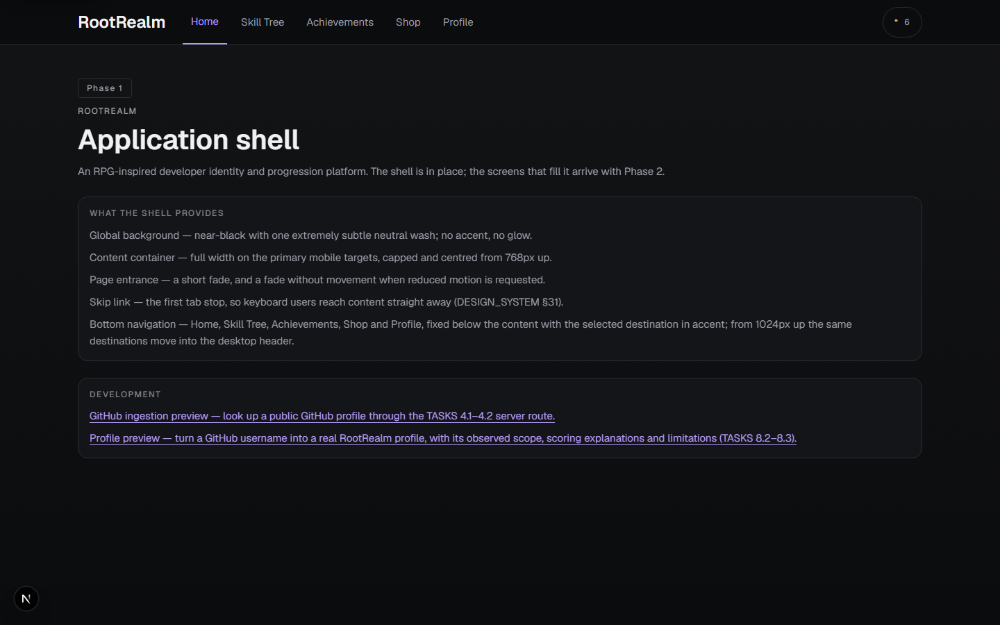
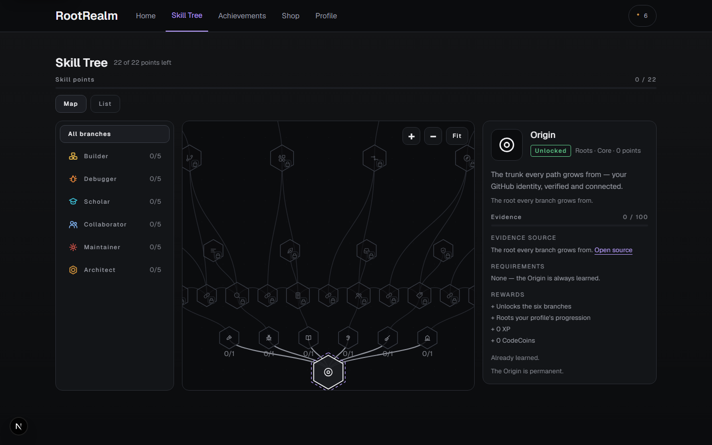
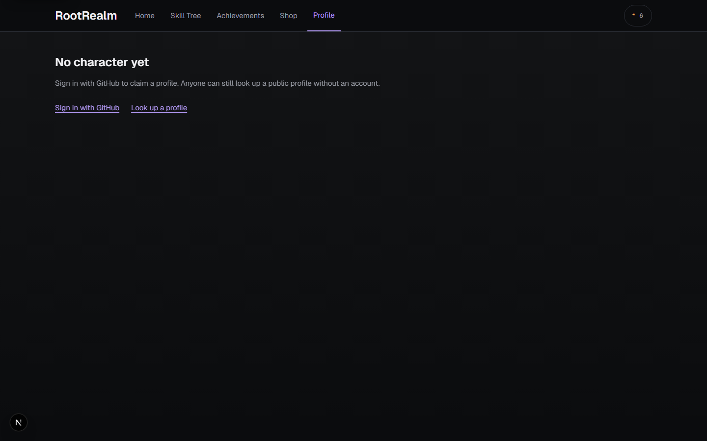
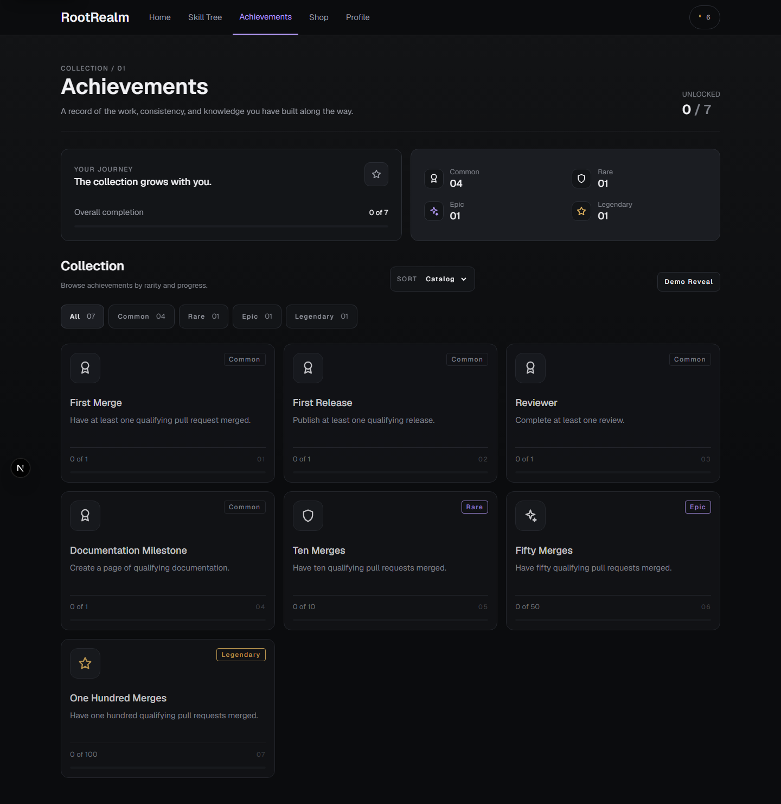

# RootRealm

An RPG-inspired developer identity and progression platform powered by GitHub
activity.

A GitHub username becomes a character: XP from merged pull requests, shipped
features, reviews and documentation; six attributes that grow with that work; a
skill tree gated on real evidence; achievements; and a cosmetic economy spent on
CodeCoins.

```text
GitHub → ingestion → normalized evidence → scoring → progression → presentation
```

---

## Quick start

```bash
npm ci                 # install exactly what the lockfile pins
cp .env.example .env.local   # then fill it in — see Environment below
npm run db:migrate     # create the schema and seed the catalogues
npm run dev            # http://localhost:3000
```

Sign-in needs a GitHub OAuth app; the app runs without one, but every
signed-in feature is unavailable until it is configured. See
[Environment variables](#environment-variables).

### What works with no configuration at all

Anyone can look up a public profile at `/preview` — that runs the real ingestion,
scoring and aggregation against live GitHub with no account.

---

## Environment variables

Copy `.env.example` to `.env.local`. Only `SESSION_SECRET` is required.

| variable | required | what it does |
| --- | --- | --- |
| `SESSION_SECRET` | **yes** | Signs the session cookie. Minimum 32 characters. Rotating it signs everyone out. |
| `GITHUB_OAUTH_CLIENT_ID` | cluster | GitHub OAuth app id. Enables sign-in. |
| `GITHUB_OAUTH_CLIENT_SECRET` | cluster | GitHub OAuth app secret. |
| `GITHUB_OAUTH_REDIRECT_URI` | cluster | Must match the callback registered on the OAuth app. |
| `GITHUB_TOKEN` | optional | A classic token with **no scopes**. Without it, ingestion runs anonymously at 60 requests/hour instead of 5000. |
| `DATABASE_URL` | optional | Supabase connection string. Without it the in-memory store is used and **data is lost on restart**. |
| `LOG_LEVEL` | optional | `debug` / `info` / `warn` / `error`. Defaults to `info`. |

The three OAuth variables are a **cluster: set all three or none.** A partial
cluster is reported as an error, because half a login configuration is worse than
no login configuration.

Generate a session secret:

```bash
node -e "console.log(require('crypto').randomBytes(32).toString('base64url'))"
```

Check an environment before deploying — it prints variable *names* only, never
values, and exits non-zero when a required one is missing:

```bash
npm run check:env
node scripts/check-environment.ts --production
```

---

## Architecture

```
GitHub
  └─ lib/github        ingestion: REST client, pagination, rate limits, normalization
      └─ lib/developer-event   canonical DeveloperEvent — the shared evidence
          ├─ lib/scoring       XP, attributes, levels, the idempotency ledger
          ├─ lib/skills        catalogue, prerequisites, unlocks
          ├─ lib/achievements  eligibility, unlocks, view state
          ├─ lib/quests        catalogue, completion, rewards
          └─ lib/currency      the append-only CodeCoin ledger
              └─ lib/shop       atomic purchase → inventory → equip

lib/sync     synchronization: job lifecycle, retries, recovery decisions
lib/profile  aggregation — the one place evidence becomes a character
lib/db       schema model, migration runner, PostgreSQL stores
lib/auth     OAuth, sessions, account claiming, account deletion
lib/ops      structured logging and environment validation
lib/security response and input boundaries
```

Three rules hold the design together:

1. **The same normalized evidence is reused everywhere.** The skill tree, the
   achievement screen and the profile all derive from one `DeveloperEvent` list.
   The UI never decides progression — it renders what the server computed.
2. **Every award is keyed.** XP transactions and coin ledger entries carry an
   idempotency key that is also the database's primary key, so a retried sync or a
   double-clicked Buy is a no-op rather than a duplicate.
3. **A purchase is atomic.** The read-decide-write runs inside one transaction,
   so "paid but not owned" is not a reachable state.

`lib/db/schema.ts` is the source of truth for the database; `db/migrations/*.sql`
is generated from it. The runner is idempotent and records what it applied.

---

## Commands

| command | what it does |
| --- | --- |
| `npm run dev` | development server |
| `npm run build` / `npm start` | production build and server |
| `npm run db:migrate` | apply migrations and seed the catalogues |
| `npm run db:reset` | drop and rebuild the schema (**development only** — refuses under `NODE_ENV=production`) |
| `npm run check:env` | validate the environment; exits non-zero when not ready |
| `npm test` | unit and integration tests |
| `npx playwright test` | end-to-end journeys |
| `npm run typecheck` / `npm run lint` | TypeScript and ESLint |

Operational scripts: `scripts/inspect-db.ts` reads back what is actually in the
database, and `scripts/verify-persistence.ts` proves a write outlives the
connection.

---

## Deploying

`docs/DEPLOYMENT.md` is the full runbook: hosting, the Supabase connection
string and why it needs `sslmode=no-verify`, the pre-release gate, the log events
worth alerting on, and backup / rollback / account / sync recovery.

Two things to know before you deploy:

- **`DATABASE_URL` must be set.** Without it every account, coin balance and
  purchase is lost on restart.
- **The OAuth callback URL must change** to your real domain, on both this app
  and the GitHub OAuth app.

---

## Screens

| route | what it is |
| --- | --- |
| `/` | landing page |
| `/preview` | public profile lookup — works without an account |
| `/profile` | your own character, with account deletion |
| `/skill-tree` | the skill tree, gated on real evidence |
| `/achievements` | every achievement, with progress |
| `/quests` | daily, weekly and goal quests |
| `/shop` | spend CodeCoins on cosmetics |
| `/customization` | equip what you own |
| `/leaderboard` | season standings |

Approved design references live in `references/approved-ui/`
(`skill-tree.png`, `node-detail.png`). `docs/VISUAL_REVIEW.md` compares the built
screens against them and records what still differs.

### Screenshots

| | |
| --- | --- |
|  |  |
|  |  |

The full set — every screen at every viewport — is regenerated by:

```bash
npx playwright test e2e/responsive.e2e.ts
# -> test-results/responsive/<viewport>-<route>.png
```

`test-results/` is gitignored because it is an artifact; the six images above are
committed. The design references they are compared against are in
[`references/approved-ui`](references/approved-ui).

---

## Testing

- **1,400+ unit and integration tests** over `lib/` and `tests/`
- **74 end-to-end journeys** across six suites: core, claim, economy, leaderboard,
  responsive audit and screen states

The E2E suite runs against a mock GitHub (`e2e/mock-github.mjs`) through a
development-only endpoint seam, and deliberately clears `DATABASE_URL` so a test
run can never write into a real database.

The responsive audit (`e2e/responsive.e2e.ts`) walks every screen at 375×812,
390×844, 768×1024, 1024×768, 1280×800 and 1440×900 and asserts no overflow,
nothing escaping the viewport, and 44px tap targets wherever a finger is used. It
writes a screenshot of each to `test-results/responsive/`, which is also how the
visual comparison in `docs/VISUAL_REVIEW.md` was made.

## Demo

The whole product is walkable without configuring anything:

1. `npm run db:migrate && npm run dev`
2. Open `/preview`, type any real GitHub username, press **Look up**.

That runs the real ingestion, scoring and aggregation against live GitHub with no
account, no OAuth app and no token. It is the fastest way to see the thing work.

To see the signed-in features — the profile, cosmetics, purchases, the leaderboard
opt-in — run in development and use the harness button ("Fund a development
wallet") that appears on the signed-out screens. It mints a session with coins in
it. It answers 404 in a production build and the control is not rendered there.

---

## Limitations

Stated plainly, because a README that lists only what works is advertising.

**Progression is recomputed on every request.** XP, attributes, levels, unlocks
and quest progress are derived from freshly-ingested GitHub activity each time a
profile is opened. Nothing about progression is persisted. The models and tables
exist for it; no write path does. Every visit costs GitHub API calls.

**The sync engine has no caller.** `lib/sync/engine.ts` implements job lifecycle,
retries and recovery decisions, and the tests cover it. No route or scheduler
invokes it at runtime, so the recovery and retry logic has never actually run in
production.

**Account deletion is a hard delete.** There is no `deleted_at`, no soft delete
and no restore path. This was deliberate — a retention promise for a deletion
request is a promise the product cannot keep — but it means an accidental deletion
is final.

**`logSyncJob` and `logRecoveryDecision` are library-only.** They are exported and
tested, but with no orchestrator there is nothing to emit them.

**Merge thresholds and rarity assignments are seeded, not derived.** Which PR
count earns a milestone, and which achievements are common versus rare, are
configured values. They have not been tuned against real data, because there is no
real user base to tune against.

**The store backend is not configurable.** With `DATABASE_URL` set it is Postgres;
without it, an in-memory store that loses everything on restart. This is
deliberate — a force-in-memory switch in production would silently lose every
purchase — but it means "local development" and "production" are the only two
modes.

**Some visual work is unfinished.** `docs/VISUAL_REVIEW.md` records the differences
that remain against the approved references: the skill tree has no minimap, and
the node detail has no Related Nodes panel and no repository-level evidence, so a
progress bar's basis is not shown next to it.

**Accessibility is designed for, not audited.** The primitives carry roles, labels
and focus handling, and reduced motion is honoured throughout, but no screen has
been through a manual screen-reader pass or a formal audit.

**No CI.** The gates are real and run on demand, but nothing runs them
automatically on a push.